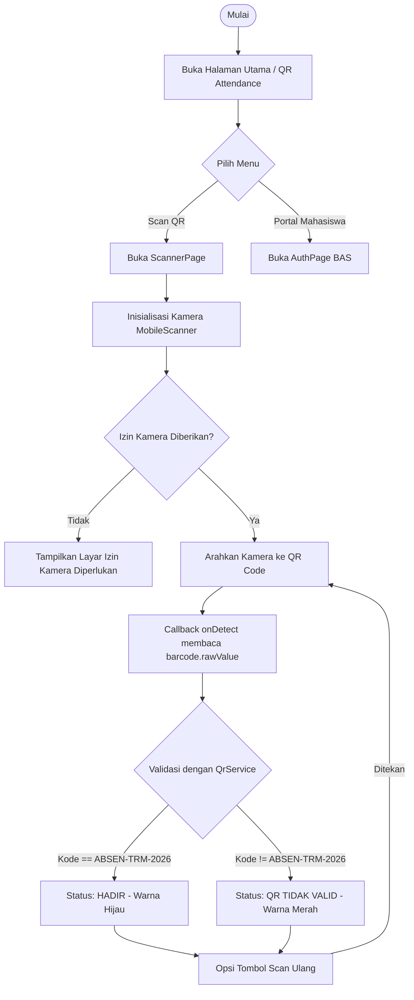

# WORKFLOW.md — User Journey dan Workflow BAS Student App & QR Attendance

## Tujuan
Dokumen ini menjelaskan alur penggunaan aplikasi demo mahasiswa dan absensi QR Code praktikum Pertemuan 6. Referensi UX adalah pola layanan mahasiswa seperti Edlink dari SEVIMA, dengan implementasi dan tampilan orisinal.

## Persona
Mahasiswa yang ingin mencatat kehadiran melalui QR Code kelas dan mengakses layanan akademik harian (jadwal kuliah, tugas, materi, nilai, presensi, KTM digital, KRS, pengumuman, dan profil).

## Struktur Navigasi Utama
Bottom navigation pada portal mahasiswa berurutan dari kiri ke kanan:

1. **Beranda**
2. **Jadwal**
3. **Akademik**
4. **Pengumuman**
5. **Profil** (*Wajib paling kanan*)

---

## User Journey Utama

| Tahap | Tujuan | Aksi Pengguna | Respons Aplikasi | Jika Gagal/Tidak Ada Data |
|---|---|---|---|---|
| **Buka Aplikasi** | Memulai penggunaan | Menjalankan aplikasi | Menampilkan halaman `HomePage` QR Attendance | Tampilkan tombol aksi ke scanner atau login |
| **Scan QR** | Absensi perkuliahan | Tekan tombol Scan QR | Kamera scanner aktif mendeteksi barcode | Tampilkan pesan permission ditolak jika izin belum diberikan |
| **Validasi QR** | Verifikasi kehadiran | Kamera mendeteksi QR kelas | Menampilkan status **HADIR** jika kode `ABSEN-TRM-2026` | Menampilkan **QR TIDAK VALID** jika kode salah |
| **Buka Portal** | Mengakses Student App | Tekan "Buka BAS Student App" | Menampilkan form login demo mahasiswa | Tampilkan pesan kredensial/koneksi jika gagal |
| **Login Demo** | Memverifikasi akun demo | Isi NPM `12523030` dan password `123456` (atau tombol autofill) | Validasi API demo, memuat profil mahasiswa, dan membuka Beranda | Tampilkan pesan error ramah |
| **Beranda** | Melihat agenda hari ini | Pilih tab Beranda | Menampilkan Jadwal Hari Ini, Tugas Terdekat, dan Akses Cepat | Tampilkan empty state yang jelas |
| **Jadwal** | Melihat kalender kuliah | Pilih mode Harian atau Mingguan | Menampilkan mata kuliah sesuai hari/pekan terpilih | Tampilkan penanda demo/empty state |
| **Akademik** | Mengakses fitur akademik | Ketuk ikon Materi, Tugas, Nilai, Presensi, KTM, atau KRS | Membuka subhalaman tujuan masing-masing fitur | Tampilkan status demo terkelola |
| **Download KTM**| Mengunduh kartu mahasiswa | Masuk ke menu KTM lalu tekan Download | Menampilkan kartu digital dan dialog unduh file PNG | Tampilkan notifikasi unduhan selesai |
| **Pengumuman** | Membaca berita kampus | Buka tab Pengumuman dan pilih item berita | Menampilkan daftar kategori dan modal rincian berita | Tampilkan status demo |
| **Profil** | Melihat identitas | Buka tab Profil (paling kanan) | Menampilkan nama, NPM, prodi, fakultas, dan statistik | Data berasal dari akun demo |
| **Logout** | Mengakhiri sesi | Tekan "Keluar dari akun" | Dialog konfirmasi -> route dibersihkan kembali ke login | - |

---

## Workflow Presensi QR Code (Pertemuan 6)

---

## Workflow Autentikasi Demo BAS

1. Tampilkan form login demo (`AuthPage`).
2. Pengguna dapat mengetik NPM dan password atau menekan tombol **"Gunakan Akun Demo"** (NPM: `12523030`, Password: `123456`).
3. Validasi lokal memastikan input tidak kosong dan NPM hanya berisi angka.
4. Hitung hash SHA-1 hex dari password input.
5. Kirim HTTP GET ke `https://6adab9277512f497b30020ef.mockapi.io/user`.
6. Ekstrak data akun; field NPM didukung dari `NPM`, `npm`, atau `userid` (`12523030`).
7. Cocokkan hash password dengan SHA-1 atau kredensial demo fallback.
8. Jika cocok, buka `WelcomeScreen` (Beranda); jika salah, tampilkan pesan error yang ramah.
9. Tombol logout di halaman Profil menghapus route aktif dan kembali ke form login.

---

## State UI yang Disediakan

- **Loading**: Indikator CircularProgressIndicator pada saat request berlangsung.
- **Success**: Data ditampilkan lengkap dengan tata letak kartu responsif.
- **Empty**: Pesan informatif jika belum ada jadwal/tugas pada hari terpilih.
- **Error**: Penanganan kegagalan koneksi, izin kamera ditolak, atau format API tidak sesuai.
- **Demo Indicator**: Banner dan keterangan transparan bahwa data untuk keperluan demonstrasi/praktikum.
