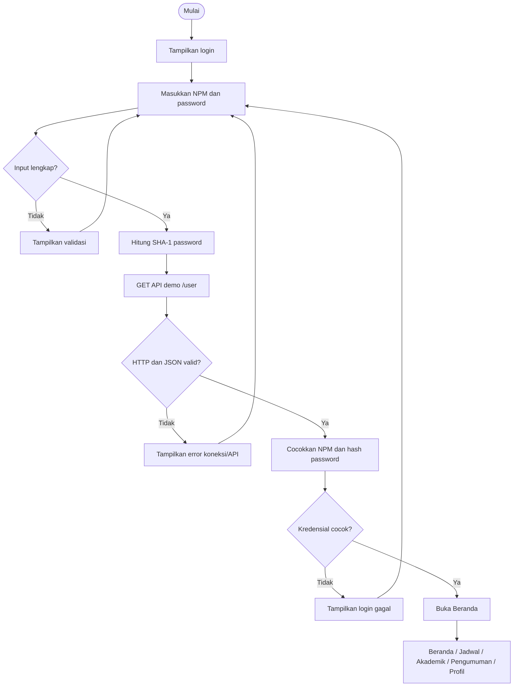

# WORKFLOW.md — User Journey dan Workflow BAS Student App

## Tujuan
Dokumen ini menjelaskan alur penggunaan aplikasi demo mahasiswa. Referensi UX adalah pola layanan mahasiswa seperti Edlink dari SEVIMA, tetapi visual dan implementasi harus tetap orisinal.

## Persona
Mahasiswa yang ingin melihat jadwal kuliah, tugas, materi, nilai, presensi, KTM, KRS, pengumuman, dan profil melalui satu aplikasi.

## Struktur navigasi utama
Bottom navigation harus berurutan dari kiri ke kanan:

1. **Beranda**
2. **Jadwal**
3. **Akademik**
4. **Pengumuman**
5. **Profil**

**Aturan wajib:** Profil selalu menjadi tab paling kanan. Label, ikon, halaman tujuan, dan urutan navigasi harus konsisten di seluruh aplikasi.

## User journey utama

| Tahap | Tujuan | Aksi pengguna | Respons aplikasi | Jika gagal/tidak ada data |
|---|---|---|---|---|
| Buka aplikasi | Memulai penggunaan | Menjalankan aplikasi | Menampilkan halaman login bila sesi belum ada | Tampilkan pesan error yang dapat ditindaklanjuti |
| Login | Memverifikasi akun demo | Isi NPM dan password, lalu tekan Masuk | Memvalidasi input, memeriksa API demo, lalu membuka Beranda jika cocok | Tampilkan validasi, kredensial salah, atau error koneksi tanpa membocorkan data |
| Beranda | Melihat hal penting hari ini | Buka tab Beranda | Melihat Jadwal Hari Ini, Tugas Terdekat, dan Akses Cepat | Tampilkan empty state bila jadwal/tugas belum tersedia |
| Jadwal | Melihat agenda kuliah | Pilih Harian atau Mingguan | Menampilkan mata kuliah sesuai hari/minggu yang dipilih | Tampilkan pesan jadwal kosong atau gagal memuat |
| Akademik | Membuka layanan akademik | Ketuk salah satu ikon fitur | Membuka halaman Materi, Tugas, Nilai, Presensi, KTM, atau KRS | Tampilkan data kosong/error atau label Demo |
| Pengumuman | Membaca informasi kampus | Buka tab Pengumuman dan pilih item | Menampilkan daftar pengumuman dan detail bila tersedia | Tampilkan empty/error state |
| Profil | Melihat identitas mahasiswa | Buka tab Profil | Menampilkan informasi mahasiswa yang tersedia | Jangan mengarang data identitas |
| Logout | Mengakhiri sesi | Pilih Keluar jika tersedia | Menghapus sesi dan kembali ke login | Jangan tampilkan logout sebagai aktif jika belum diimplementasikan |

## Workflow autentikasi demo

1. Tampilkan halaman login.
2. Pengguna mengisi NPM dan password.
3. Validasi bahwa kedua input tidak kosong.
4. Hitung SHA-1 hex dari password input menggunakan UTF-8 sesuai kontrak API demo.
5. Kirim GET ke `https://6adab9277512f497b30020ef.mockapi.io/user`.
6. Pastikan respons HTTP berhasil dan JSON valid.
<<<<<<< HEAD
7. Cari record yang field `NPM`-nya cocok dengan NPM input dan field `Password`-nya cocok dengan hash yang dihitung.
8. Jika cocok, lanjutkan ke Beranda; jika tidak, tampilkan pesan login gagal.
9. Tangani timeout, koneksi gagal, JSON tidak valid, respons kosong, dan error server.
10. Jangan mencatat atau menampilkan password/hash di UI atau log.
=======
7. Baca NPM dari field `NPM` atau `npm`, dan hash tersimpan dari `Password` atau `pass_sha1`.
8. Pastikan record memiliki kedua field tersebut, lalu cocokkan NPM dan SHA-1 dengan input.
9. Jika cocok, lanjutkan ke Beranda; jika tidak, tampilkan pesan login gagal.
10. Jika endpoint tidak menyertakan NPM dan hash, tampilkan petunjuk konfigurasi field, bukan pesan kredensial salah.
11. Tangani timeout, koneksi gagal, JSON tidak valid, respons kosong, dan error server.
12. Jangan mencatat atau menampilkan password/hash di UI atau log.
>>>>>>> f8fc6fe (Revisi)

**Catatan keamanan:** alur ini hanya untuk demo. SHA-1 dan pemeriksaan password dari API publik tidak aman untuk produksi. Gunakan backend autentikasi yang aman sebelum dipakai untuk data mahasiswa sungguhan.

## Workflow halaman Beranda

1. Pengguna memilih tab **Beranda**.
2. Aplikasi memuat data yang tersedia.
3. Bagian **Jadwal Hari Ini** menampilkan mata kuliah hari ini berdasarkan urutan waktu. Informasi dapat meliputi nama mata kuliah, jam, ruang, dan dosen jika tersedia.
4. Bagian **Tugas Terdekat** menampilkan tugas yang tenggatnya paling dekat, beserta nama mata kuliah dan tanggal tenggat jika tersedia.
5. Bagian **Akses Cepat** menampilkan ikon/tile untuk membuka Materi, Tugas, Nilai, Presensi, KTM, dan KRS di dalam menu Akademik.
6. Bila tersedia, pengumuman terbaru dapat ditampilkan sebagai ringkasan dengan tautan ke tab Pengumuman.
7. Jika data kosong, tampilkan pesan yang menjelaskan bahwa data belum tersedia. Jangan membuat data contoh tampak seperti data asli.

## Workflow halaman Jadwal

### Tampilan Harian
1. Pengguna membuka tab **Jadwal**.
2. Pilih mode **Harian** dan tanggal/hari.
3. Aplikasi menampilkan mata kuliah pada hari tersebut dalam urutan jam.
4. Tiap item menampilkan informasi yang tersedia: nama mata kuliah, kode/kelas, jam mulai–selesai, ruang, dan dosen.
5. Pengguna dapat memilih hari/tanggal lain.

### Tampilan Mingguan
1. Pengguna memilih mode **Mingguan**.
2. Aplikasi menampilkan jadwal satu minggu, dikelompokkan per hari.
3. Pengguna dapat berpindah ke minggu sebelumnya/berikutnya bila fitur didukung.
4. Pada layar kecil, gunakan daftar atau kartu per hari agar jadwal mudah dibaca dan tidak overflow.

Jika jadwal belum tersedia, tampilkan empty state. Jika pemuatan gagal, tampilkan pesan dan aksi coba lagi bila sesuai.

## Workflow halaman Akademik

<<<<<<< HEAD
Halaman Akademik menampilkan enam ikon/menu yang masing-masing membuka halaman sendiri:
=======
Halaman Akademik menampilkan enam ikon/menu utama yang masing-masing membuka halaman sendiri:
>>>>>>> f8fc6fe (Revisi)

| Menu | Isi dan alur |
|---|---|
| **Materi** | Pilih mata kuliah, lihat daftar materi, lalu buka file/tautan bila tersedia. |
| **Tugas** | Lihat daftar tugas, mata kuliah, tenggat, dan status pengumpulan jika didukung. Buka detail tugas untuk instruksi lengkap bila tersedia. |
| **Nilai** | Pilih semester atau mata kuliah dan lihat nilai yang tersedia. Jangan membuat nilai palsu. |
| **Presensi** | Lihat ringkasan kehadiran dan riwayat. Aksi presensi hanya boleh dinyatakan berhasil setelah menerima konfirmasi backend. |
<<<<<<< HEAD
| **KTM** | Tampilkan kartu mahasiswa digital berdasarkan data tepercaya yang tersedia. Jangan mengarang nama, NPM, foto, atau program studi. |
| **KRS** | Pilih semester, lihat mata kuliah dan total SKS jika tersedia, kemudian lihat status pengajuan. Pengajuan hanya dianggap berhasil jika dikonfirmasi backend. |

=======
| **KTM** | Tampilkan kartu mahasiswa digital berdasarkan data tepercaya yang tersedia. Jangan mengarang nama, NPM, foto, atau program studi. Buat KTM tersebut bisa didownload |
| **KRS** | Pilih semester, lihat mata kuliah dan total SKS jika tersedia, kemudian lihat status pengajuan. Pengajuan hanya dianggap berhasil jika dikonfirmasi backend. |

Halaman Akademik juga menyediakan menu **DHS** sebagai pusat layanan hasil studi.
Alurnya: pilih **DHS > DHS Kuliah** untuk membuka catatan nilai yang
dikelompokkan menurut semester/tahun akademik. Data berasal dari
`GET https://6adab9277512f497b30020ef.mockapi.io/nilai?npm={npm}`; respons
MockAPI menggunakan properti `value` untuk daftar data. Tampilan merujuk pola
umum DHS/KHS mahasiswa (rekap mata kuliah dan nilai per semester), tanpa
mengklaim sebagai transkrip resmi. Kode mata kuliah, komponen nilai, NA, HM,
AM, NIP, dan semester hanya ditampilkan jika tersedia. Nama mata kuliah, SKS,
dan IPK/IPS tidak disimpulkan dari data yang tidak disediakan.

Endpoint `/nilai` khusus data nilai. Login tetap menggunakan endpoint
`/user`, karena endpoint nilai tidak memiliki kontrak autentikasi.

>>>>>>> f8fc6fe (Revisi)
Setiap menu harus memiliki label teks, ikon yang mudah dipahami, area sentuh yang memadai, dan state loading/empty/error. Jika belum terhubung backend, tandai jelas sebagai **Demo**.

## Workflow halaman Pengumuman

1. Pengguna memilih tab **Pengumuman**.
2. Aplikasi menampilkan daftar pengumuman dalam bentuk kartu atau list.
3. Item menampilkan judul, ringkasan, tanggal, serta kategori/sumber bila tersedia.
4. Pengguna mengetuk item untuk membuka detail jika detail tersedia.
5. Status baru/belum dibaca hanya ditampilkan jika memang dikelola oleh aplikasi atau backend.
6. Jika tidak ada data, tampilkan empty state. Jika terjadi kegagalan, tampilkan error dan opsi coba lagi bila sesuai.

Jangan mengarang pengumuman resmi kampus. Gunakan gaya pengalaman pengguna yang familiar, tetapi jangan menyalin aset atau identitas proprietary Edlink.

## Workflow halaman Profil

1. Pengguna memilih tab **Profil** (tab paling kanan).
2. Aplikasi menampilkan identitas mahasiswa yang tersedia, misalnya foto/avatar, nama, NPM, program studi, dan fakultas.
3. Data yang tidak tersedia tidak boleh direkayasa atau ditampilkan sebagai informasi asli.
4. Untuk membuka KTM, pengguna diarahkan ke **Akademik > KTM**.
5. Jika sesi dan logout sudah diimplementasikan, pengguna dapat memilih Keluar, sesi dihapus, lalu aplikasi kembali ke login.

## State UI yang wajib tersedia

- **Loading:** indikator proses; cegah aksi ganda yang tidak perlu.
- **Success:** tampilkan data dan aksi relevan.
- **Empty:** jelaskan bahwa data belum tersedia dan jangan membuat konten palsu.
- **Error:** pesan ramah dan aksi coba lagi jika sesuai.
- **Demo:** beri penanda jelas untuk fitur yang belum terhubung ke backend resmi.

## Checklist uji manual

### Navigasi
- [ ] Urutan tab: Beranda, Jadwal, Akademik, Pengumuman, Profil.
- [ ] Profil berada paling kanan.
- [ ] Setiap tab membuka halaman yang tepat.
- [ ] Ikon Akses Cepat di Beranda membuka fitur tujuan yang sesuai.
- [ ] Enam ikon Akademik membuka menu masing-masing.
- [ ] Konten tidak tertutup bottom navigation dan tidak overflow pada layar kecil.

### Beranda dan Jadwal
- [ ] Beranda memiliki bagian Jadwal Hari Ini.
- [ ] Beranda memiliki bagian Tugas Terdekat.
- [ ] Beranda memiliki Akses Cepat yang berfungsi.
- [ ] Jadwal mendukung tampilan Harian dan Mingguan.
- [ ] Jadwal kosong dan error pemuatan ditangani.

### Akademik, Pengumuman, Profil
- [ ] Materi, Tugas, Nilai, Presensi, KTM, dan KRS tersedia sebagai menu terpisah.
- [ ] Fitur akademik tidak mengarang data dan diberi label Demo jika belum terhubung backend.
- [ ] Pengumuman menampilkan daftar dan detail jika tersedia.
- [ ] Empty state dan error state Pengumuman tampil dengan benar.
- [ ] Profil hanya menampilkan data yang tersedia.
- [ ] Logout berfungsi hanya jika benar-benar diimplementasikan.

### Login demo
- [ ] NPM kosong ditolak.
- [ ] Password kosong ditolak.
- [ ] NPM tidak dikenal ditolak.
- [ ] Password salah ditolak.
- [ ] Kredensial valid dari API demo dapat masuk.
- [ ] API/koneksi gagal tidak membuat aplikasi crash.
- [ ] JSON tidak sesuai kontrak ditangani.
- [ ] Submit ganda dicegah saat loading.
- [ ] Password/hash tidak ditampilkan di UI/log.

## Kriteria selesai
Navigasi sesuai urutan yang ditentukan; setiap halaman utama dan menu Akademik memiliki alur yang jelas; kondisi loading, empty, dan error ditangani; hasil `flutter analyze`, `flutter test`, dan build dicatat berdasarkan pengujian nyata. Fitur yang belum memiliki backend resmi harus ditandai sebagai demo.
