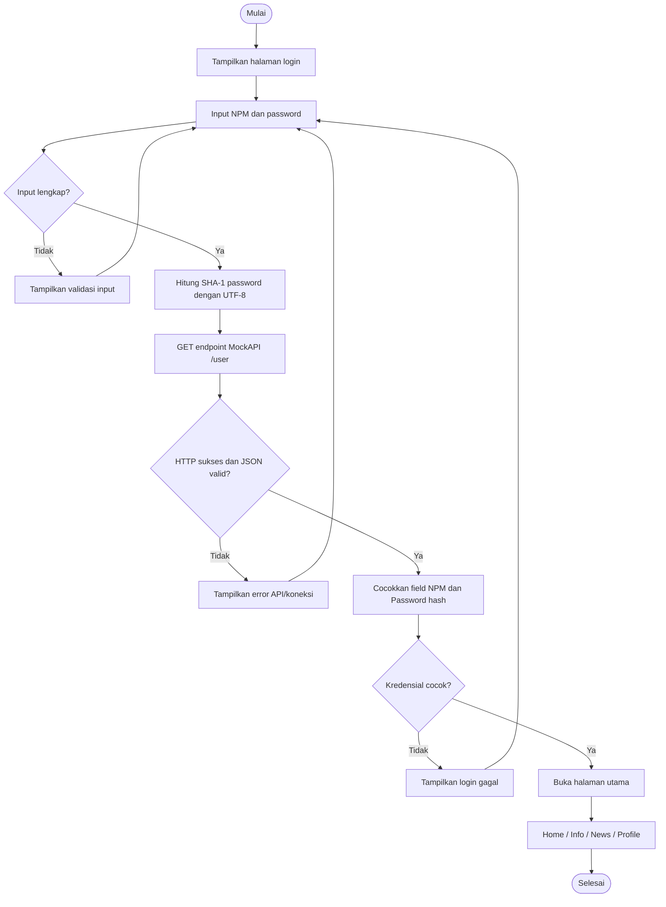

# WORKFLOW.md — User Journey dan Workflow BAS Student App

## Persona
Mahasiswa yang ingin mengakses informasi kampus, berita, profil/KTM, presensi, dan KRS dari satu aplikasi.

## User journey

| Tahap | Tujuan | Aksi | Respons aplikasi | Penanganan gagal |
|---|---|---|---|---|
| Buka aplikasi | Memulai | Menjalankan aplikasi | Halaman login tampil | Error yang dapat ditindaklanjuti |
| Isi login | Memasukkan identitas | Isi NPM dan password | Validasi input dan loading | Minta input kosong dilengkapi |
| Verifikasi | Memastikan akun valid | Tekan Masuk | API demo diperiksa, NPM dan SHA-1 password dicocokkan | Pesan kredensial salah/koneksi gagal tanpa membocorkan data |
| Home | Melihat ringkasan | Pilih Home | Ringkasan dan pintasan tampil | Empty state jika data belum ada |
| Info | Menemukan info | Pilih Info dan item | Konten tersedia ditampilkan | Pesan jika tidak ada hasil |
| News | Membaca berita | Pilih News, cari/filter | Daftar berita tampil | Jelaskan jika detail belum tersedia |
| Profile/KTM | Memeriksa identitas | Pilih Profile | Data yang tersedia ditampilkan | Jangan mengarang data |
| Presensi | Memeriksa/melakukan presensi | Buka pintasan | Status demo atau respons backend tampil | Jangan mengklaim sukses tanpa konfirmasi backend |
| KRS | Memeriksa mata kuliah | Buka KRS | Mata kuliah/SKS tampil jika tersedia | Tandai demo bila backend belum ada |
| Keluar | Mengakhiri sesi | Pilih logout jika tersedia | Sesi dihapus dan kembali ke login | Catat jika belum diimplementasikan |

## Workflow autentikasi

**Catatan:** alur login ini hanya untuk demo. API publik dan validasi hash di perangkat tidak aman untuk produksi.

## Navigasi bawah
Urutan wajib: **Home → Info → News → Profile**.
- Home: ringkasan dan pintasan fitur mahasiswa.
- Info: informasi kampus/akademik.
- News: berita dan pengumuman.
- Profile: profil dan akses KTM.

**Aturan:** Profile selalu item terakhir/paling kanan. Urutan daftar tab dan daftar halaman harus sinkron.

## Workflow fitur yang direkomendasikan

### Presensi
1. Mahasiswa membuka Presensi.
2. Aplikasi menampilkan jadwal/status hari ini.
3. Mahasiswa memilih aksi yang tersedia.
4. Backend memvalidasi identitas, jadwal, waktu, dan aturan.
5. Aplikasi menampilkan hasil setelah konfirmasi backend.
6. Mahasiswa melihat riwayat.
Jika backend belum tersedia, tandai alur **Demo**.

### KTM digital
1. Buka Profile/KTM.
2. Ambil data dari sumber tepercaya.
3. Tampilkan nama, NPM, program studi, foto hanya jika tersedia.
4. Tangani loading, data kosong, dan error.

### KRS
1. Buka KRS dan pilih semester.
2. Tampilkan daftar mata kuliah.
3. Buka detail/pilih mata kuliah jika didukung.
4. Validasi total SKS/prasyarat melalui backend.
5. Tinjau ringkasan.
6. Kirim pengajuan dan tampilkan status yang dikonfirmasi backend.

## State UI wajib
- **Loading:** indikator proses dan cegah submit berulang.
- **Success:** tampilkan data dan aksi relevan.
- **Empty:** jelaskan data belum tersedia.
- **Error:** pesan ramah dan coba lagi bila sesuai.

## Checklist uji manual
- [ ] NPM kosong ditolak.
- [ ] Password kosong ditolak.
- [ ] NPM tidak dikenal ditolak.
- [ ] Password salah ditolak.
- [ ] Kredensial valid dari API demo bisa masuk.
- [ ] API/koneksi gagal tidak membuat crash.
- [ ] JSON di luar kontrak ditangani.
- [ ] Tidak bisa submit ganda saat loading.
- [ ] Tiap tab membuka halaman yang benar.
- [ ] Urutan Home, Info, News, Profile benar.
- [ ] Profile paling kanan.
- [ ] Konten tidak tertutup navigasi.
- [ ] Fitur tanpa backend diberi label demo.

## Kriteria selesai
Login dan navigasi lulus uji manual; hasil analyzer/test dicatat; fitur tanpa backend tidak mengklaim transaksi akademik sungguhan.
